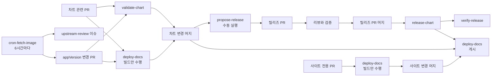

# CI / 지속적 검증

이 저장소에는 여섯 개의 GitHub Actions workflow가 있어 변경사항을 검증하고,
문서 사이트를 게시하며, upstream 이미지를 추적하고, 서명된 차트 아티팩트를
릴리즈합니다.

| Workflow | 트리거 | 역할 |
|---|---|---|
| [validate-chart.yaml](../../../.github/workflows/validate-chart.yaml) | 차트, 테스트, 검증 스크립트 또는 이 workflow를 변경하는 pull request | 머지 전 lint, 생성 문서 드리프트 확인, 격리된 **kind** 설치/테스트 시나리오 |
| [deploy-docs.yaml](../../../.github/workflows/deploy-docs.yaml) | 사이트가 렌더링하는 대상(`docs/`, 각 README, `charts/`, `examples/`, `mkdocs.yml` 등)을 건드리는 pull request와 `main` push, 수동 실행, 릴리즈 갱신 | 엄격한 링크 검사로 사이트를 빌드하고 pull request 외 실행에서 GitHub Pages에 배포 |
| [cron-fetch-image.yaml](../../../.github/workflows/cron-fetch-image.yaml) | 6시간마다 또는 수동 실행 | 새 upstream 이미지를 감지하고 appVersion 변경 PR과 upstream-review 이슈 생성 |
| [propose-release.yaml](../../../.github/workflows/propose-release.yaml) | 수동 실행 | 게시하지 않고 대기 중인 Changeset을 검토 가능한 릴리즈 PR 하나로 변환 |
| [release-chart.yaml](../../../.github/workflows/release-chart.yaml) | `charts/hermes-agent/Chart.yaml`을 바꾸는 `main` push | `vX.Y.Z` 태그 생성, OCI와 Helm Repository 게시, OCI cosign 서명 및 Pages 갱신 |
| [verify-release.yaml](../../../.github/workflows/verify-release.yaml) | `release-chart` 성공 이후 또는 게시된 버전의 수동 실행 | **게시되어 서명된** 아티팩트를 처음부터 끝까지 다시 검증 |

## workflow 연결 구조



예약 실행 경로는 일반 pull request와 검토 이슈를 만드는 데서 멈춥니다. 차트를
직접 게시하지 않습니다. 메인테이너가 Changesets 릴리즈 PR을 준비하고 검토한 뒤
머지해야 게시가 시작됩니다.

## validate-chart

기능적 변경마다 job 두 개가 실행됩니다:

### `lint`

`helm lint`, `helm template`, `dashboard` 블록의 렌더링 전용 검증
(`.github/scripts/assert-dashboard-render.sh`), 그리고 **helm-docs 드리프트 체크** - `charts/hermes-agent/README.md`가
`README.md.gotmpl` 대비 오래됐거나 번역된 차트 README에 있는 `## Values` 표 복사본이
다르면 job이 실패합니다. `values.yaml`을 수정한
뒤에는 항상 `make docs`를 실행하고 결과를 커밋하세요.

### `test`

시나리오 여덟 개가 **매트릭스**로 실행되며, 각각 **독립된 임시 kind
클러스터**(별도 러너)에서 돕니다 - 완전히 격리되어 있고, 하나로 뭉친 로그
대신 job별로 고유한 상태·타임아웃·실패 진단을 갖습니다. PR 체크 목록에는
`test (message)`, `test (existing-claim)`, `test (team)`,
`test (security-hardened)`, `test (bootstrap-overwrite)`,
`test (config-migration)`, `test (dashboard-ingress)`, `test (image-contract)`로 따로
표시됩니다.
시나리오 로직은 workflow에 인라인으로 있지 않고
[.github/scripts](../../../.github/scripts)(`lib.sh` + 시나리오별 스크립트)에
있습니다.

`changes` job은 버전 범프만 있는(차트 동작이 바뀌지 않는) 커밋에는 `test`
자체를 건너뜁니다.

#### message 시나리오: [scenario-message.sh](../../../.github/scripts/scenario-message.sh)

1. 차트가 관리하는 스토리지로 설치.
2. 차트의 `hermes doctor` 테스트 훅을 실행(`helm test`와 같은 Job이지만,
   hook watch에서 멈추지 않도록 직접 호출).
3. **신뢰된 차트·이미지·라이브 하네스 변경에서만**(`NVIDIA_API_KEY` 시크릿이 있을 때):
   PVC에 `skills/ci-ping/SKILL.md`를 주입하고 검색되는지 확인한 다음,
   스킬 사용을 명시적으로 요청해 NVIDIA NIM을 통한 `hermes chat` 라운드트립을 실행합니다.

문서와 릴리즈 도구 변경도 functional 매트릭스가 선택한 구조적 차트 설치 검사는
유지하지만, 외부 모델과 Discord 전달 검사는 건너뜁니다.
`requires-live-chat.py`가 실제 diff로 이 범위를 판단합니다.
차트 입력·이미지·라이브 테스트 하네스 변경은 외부 검사를 유지하며,
기준 커밋 기록이 없으면 외부 검사를 켠 상태로 처리합니다.

`CI_MODELS` 풀은 **failover 전용**입니다. 모든 모델이 아니라 정확히 `CI_PONG`을
먼저 반환한 모델에서 통과합니다. PR과 릴리즈 후 검사는 같은 스킬과 검색 확인
함수를 사용합니다. `--skills ci-ping`으로 스킬을 미리 불러오고 `--quiet`로 최종
응답만 검사합니다. 빈 응답이나 다른 답변은 종료 코드가 0이어도 통과하지 않습니다.
각 시도에는 시간 제한이 있고 실패하면 다음 모델로 넘어갑니다.

라이브 Discord 알림 단계(workflow 레벨, 시나리오 스크립트 이후)는 이
시나리오에서만 실행됩니다 - Discord가 켜져 있는 유일한 시나리오이기
때문입니다.

#### existingClaim 시나리오: [scenario-existing-claim.sh](../../../.github/scripts/scenario-existing-claim.sh)

`persistence.existingClaim`(차트가 만드는 대신 이미 존재하는 PVC를 마운트하는
기능 - [PR #37](https://github.com/jyje/hermes-agent-helm/pull/37))을
검증합니다:

1. 차트 **바깥에서** `ci-shared-pvc` PVC 생성.
2. `--set persistence.existingClaim=ci-shared-pvc`로 설치.
3. `hermes doctor` 테스트 훅 통과 확인.
4. 파드에 exec로 들어가 `${HERMES_HOME}/ci-claim-probe.txt`를 쓰고 읽기.
5. `hermes doctor` 재실행.

이건 **스모크 테스트**입니다: 차트가 미리 만들어진 PVC에 바인딩되어 깨끗하게
시작함을 증명합니다. 재시작/업그레이드 사이의 영속성은 후속 과제로
남아 있습니다.

별도의 `team` 시나리오는 `hermes-team-knowledge`를 RWX로 준비해 리더에는
읽기/쓰기로, 멤버에는 읽기 전용으로 마운트하고, 리더가 프로브를 쓰고
멤버가 이를 교차로 읽은 뒤, 멤버의 쓰기가 거부되는지 확인합니다. 이렇게
멀티 인스턴스 공유 지식의 경계를 검증하되, 이 볼륨을 작업 핸드오프
경로로 취급하지는 않습니다.

`security-hardened` 시나리오는 Pod Security Standards `restricted`를 강제한
네임스페이스에 `values-hardened.yaml`을 설치합니다. 렌더링된 securityContext를
검증하고, 허용된 읽기 전용 root filesystem Pod에서 `hermes doctor`를 실행합니다.

`bootstrap-overwrite` 시나리오는 영속 config 계약을 검증합니다.
`bootstrap.overwrite=false`로 설치하고, 실행 중인 Pod의 `config.yaml`에 마커를
쓴 뒤, 무해한 Pod annotation으로 seed init container가 다시 실행되도록 업그레이드합니다.
새 Pod에도 마커가 남아 있어야 런타임 편집이 업그레이드 뒤에도 보존됨을 증명합니다.

`config-migration` 시나리오는 Hermes `v2026.9.21`과 영속 PVC를 사용합니다.
첫 실행, `bootstrap.overwrite=true` 교체, `false` 보존 및 마이그레이션, 지원하지 않는
버전의 안전한 거부, 문서화된 운영자 migration-floor 절차를 확인합니다. 완료된 스키마
버전과 마이그레이션 전 백업도 검증합니다.

`dashboard-ingress` 시나리오는 자체 kind 클러스터에 버전을 고정한 ingress-nginx 컨트롤러를
설치하고 TLS Ingress를 통해 대시보드에 접근합니다. 파드는 대시보드가 리슨한 뒤에야 Ready가
되어야 하므로(readiness probe) `helm --wait` 직후 Ingress가 응답해야 합니다. 인증 게이트는
인증 없는 요청과 틀린 비밀번호를 거부해야 하고, 로그인하면 컨트롤러 파드가
`dashboard.trustedProxies`에 들어 있으므로 `Secure`, `HttpOnly`인 `__Host-` 세션 쿠키가
설정되어야 합니다. 신뢰 프록시 없이 업그레이드한 대조군에서는 쿠키에 `Secure`가 붙지
않는지 확인하며, 이것이 해당 값을 설정해야 하는 문서화된 이유입니다. 호스트는 `curl
--resolve`로 해석하는 예약 `.test` 이름이고 인증서는 자체 서명이라 DNS나 공인 인증서가
필요 없습니다. 업스트림이 loopback 호스트를 개발 환경으로 보고 `Secure`를 설정하지
않으므로 여기서는 `*.localhost` 호스트를 쓰지 마세요. 실제 DNS와 Let's Encrypt 발급은
실제 클러스터에서 수동으로 검증합니다.

`image-contract` 시나리오는 Hermes 이미지 안에서 실행되고 기본으로 꺼져 있어서 다른
시나리오가 건드리지 못하는 차트 경로 두 가지를 지킵니다. OpenAI Codex 디바이스 로그인은
`hermes_cli.auth`에서 함수를 불러오고, 준비 완료 메시지는 Hermes가 프로세스 안에서
로드하는 `gateway:startup` 훅입니다. 이 시나리오는 두 기능을 켜고 차트를 설치한 뒤
(메인 Pod가 사람이 로그인 코드를 승인하기를 기다리므로 `--wait` 없이) Helm test Job을
실행하고 두 점검이 모두 `OK`를 보고해야 통과합니다. 함수 점검은 import이고, 훅 점검은 알 수
없는 채널을 설정해 핸들러가 로그만 남기고 돌아오게 하며, 레지스트리가 핸들러 오류를
삼키므로 그 핸들러의 로그 줄을 요구합니다. 시크릿도 제공자 호출도 필요 없어서 포크 PR에서도
돕니다. 이미지를 올렸을 때 둘 중 하나의 이름이 바뀌거나 옮겨지면 사용자의 로그인이나
준비 완료 메시지가 조용히 깨지는 대신 이 시나리오가 빠진 이름과 함께 실패합니다.

### Fork PR

Fork PR은 저장소 시크릿을 받지 못하므로, chat 라운드트립(그리고 라이브
Discord 체크)은 건너뛰고 **doctor 전용**으로 폴백합니다 - 안전하면서도
여전히 의미 있는 검증입니다.

## deploy-docs

이 workflow의 경로 필터는 `docs/`보다 넓게, 사이트가 렌더링하는 저장소
소스를 모두 포함합니다. 루트 README, SECURITY, CONTRIBUTING의 영문 및 한글
문서, `charts/`, `examples/`, `mkdocs.yml`, `main.py`, `hooks.py`,
`requirements.txt`가 모두 해당합니다. 차트만 바꾼 pull request도 이
workflow를 실행하는데, 차트 README가 사이트의 일부이기 때문입니다.

pull request는 `mkdocs build --strict`를 실행하고 사이트 아티팩트를
업로드하지만 배포하지는 않습니다. 같은 변경이 `main`에 머지되거나, 수동
실행하거나, `release-chart`가 갱신을 요청하면 GitHub Pages Actions API를 통해
빌드된 사이트를 배포합니다.

이 workflow는 `gh-pages` 브랜치의 `index.yaml`과 패키징된 차트 아카이브를
사이트 출력에 병합합니다. 이 브랜치는 Helm Repository 데이터 저장소이고,
`deploy-docs`만 Pages 사이트를 게시합니다.

## cron-fetch-image

`0 */6 * * *` 스케줄은 UTC 기준 00:00, 06:00, 12:00, 18:00에 실행됩니다.
수동 실행도 같은 절차를 따릅니다.

1. Docker Hub에서 `nousresearch/hermes-agent` 릴리즈 태그(`vX.Y.Z`)를
   가져옵니다. `rc.*`, `-desktop`, 아키텍처별, `stable`, `latest` 태그는 무시합니다.
2. 최신 태그를 차트의 현재 `appVersion`과 비교합니다. 날짜 기반
   `appVersion`(upstream이 `v2026.9.24`까지 쓰던 `vYYYY.M.D` 형식)은 모든
   semver 태그보다 오래된 것으로 취급합니다.
3. 새 이미지가 있으면 minor Changeset을 포함한 appVersion 변경 PR을 만듭니다.
4. 일치하는 Docker 태그가 없는 경우도 포함해 GitHub의 정식 안정 릴리즈를
   독립적으로 조회합니다. 원문을 가져오고 릴리즈별 Helm lint와
   Deployment·StatefulSet 렌더 검사를 수행한 뒤 NVIDIA NIM으로 차트 영향을
   검토합니다. 관련 후속 작업마다 레이블이 있는 이슈를 만듭니다.

버전 변경과 upstream-review job은 서로 독립적입니다. 메인테이너는 모든 후속
이슈의 구현을 기다리지 않고 일반 검증을 통과한 이미지 변경을 머지할 수 있습니다.

appVersion이 최신이거나 이미지 PR·브랜치가 이미 있어도 정식 릴리즈 검토는
실행됩니다. 수동 입력 `review_only=true`는 이미지 변경 제안을 건너뛰고,
`review_from=v0.21.6`는 포함할 SemVer 시작점을 지정하며,
`force_review=true`는 기록된 원문까지 다시 검토합니다. 검토 전용 실행도
이슈를 만들고 NIM 시크릿을 사용할 수 있습니다.

저장소의 수동 검토 기준선에는 2026-10-17에 검토한 전환기 릴리즈 5개를
기록합니다. 이후 완료된 원문의 digest를 실행 사이에 캐시하며, 캐시가 사라지면
검토 완료로 가정하지 않고 다시 검토합니다. 한 릴리즈가 실패해도 나머지를
검사하며 완료된 결과만 원장에 기록합니다. 원문이 바뀌면 다시 검토합니다.
차트 커밋·원문·릴리즈별 검사·누락된 섹션·원장은 실행 아티팩트에 90일간
보존합니다. 정적 검사이며 이미지 지원 보장이나 실제 PVC·인증 검증은 아닙니다.

upstream 검토는 결과를 항상 드러내서 알립니다.

- **미검토.** `NVIDIA_API_KEY` secret이 없으면 해당 릴리즈를 미검토로 기록하고
  나중에 재시도합니다. 검토 원장의 완료 기록은 갱신하지 않습니다.
- **실패.** NIM이 모든 시도에서 오류나 쓸 수 없는 응답을 돌려주면 "Automated
  upstream review failed - review manually"라는 `upstream-review` 이슈를 하나
  만들고 job을 실패시킵니다. 검토가 실패했는데 "올릴 이슈 없음"으로 보고하는
  일은 없습니다. 원문이 없거나 비어 있는 경우, 정적 검사 실패,
  중요한 업그레이드·보안·되돌림 섹션 누락도 수동 검토 이슈를 만들고 실행을 실패시킵니다.
- **입력 축약.** 릴리즈 노트가 글자 수 예산(`NIM_MAX_NOTES_CHARS`, 기본값
  60000)을 넘으면 호출 전에 줄입니다. highlights, upgrade, breaking,
  security, gateway, infrastructure, revert 섹션을 먼저 담고, 기여자 목록과 테스트
  변경 내역은 뺍니다. 빠진 섹션 이름은 프롬프트와 생성된 각 이슈에 적힙니다.
  시도가 실패하면 예산을 절반으로 줄여 다시 시도하고, 로그에 HTTP 상태와 응답
  앞부분을 남깁니다.

## propose-release

대기 중인 Changeset이 릴리즈 준비를 마치면 메인테이너가 이 workflow를
실행합니다. 하나의 릴리즈 PR로 결합하고 릴리즈 manifest, `Chart.yaml`,
Artifact Hub 어노테이션, 생성된 차트 문서, 버전이 포함된 예제를 동기화합니다.
차트를 게시하지는 않습니다.

## release-chart

릴리즈 PR을 머지하면 `main`의 차트 버전이 바뀌고 이 workflow가 시작됩니다.
해당 버전 태그가 아직 없다면 다음 작업을 수행합니다.

1. `vX.Y.Z` 태그와 GitHub Release를 생성합니다.
2. 차트를 패키징해 OCI에 게시합니다.
3. keyless cosign으로 OCI 아티팩트에 서명합니다.
4. `gh-pages`의 Helm Repository 데이터를 갱신합니다.
5. 문서 사이트와 Helm Repository 인덱스를 함께 제공하도록 `deploy-docs`를
   실행합니다.

## verify-release

릴리즈가 게시된 뒤, 이 workflow는 사용자가 실제로 pull하는 아티팩트를
기준으로 전체 공급망을 증명합니다(네임스페이스 `verify-hermes-chart`):

1. 이 저장소의 Actions OIDC 아이덴티티로 OCI 아티팩트를 **cosign verify**.
2. (로컬 소스가 아니라) **OCI 레지스트리에서** `helm install`.
3. `validate-chart`와 같은 `hermes doctor` + chat 라운드트립 실행.

릴리즈 태그에서 차트 버전과 불변 릴리즈 SHA를 결정하고, 워크플로 자신의
커밋에서 테스트 하네스를 가져옵니다. 로그에는 두 SHA를 모두 남깁니다.
하네스를 수정한 뒤 같은 아티팩트를 재게시하지 않고 검증하려면:

```bash
gh workflow run verify-release.yaml --ref main -f version=1.21.0
```

수동 버전은 `X.Y.Z` 형식이어야 하며, 기존 태그와 차트 메타데이터가 일치해야
합니다. 자동 릴리즈가 no-op이면 기존과 같이 아티팩트 검증을 건너뜁니다.
실패는 근거로 분류하세요. 서명·설치 문제, 하네스 문제, 외부 모델·네트워크
실패는 별개이며 모델 요청 실패만으로 게시된 차트가 깨졌다고 판단하지 않습니다.

## 로컬에서 동등한 작업 실행하기

```bash
make lint        # helm lint
make template    # 매니페스트 렌더링
make docs        # 차트 README 재생성(helm-docs) - 결과를 커밋하세요
make test        # 설치 + helm test(클러스터/kind 필요)
```

로컬 kind 클러스터 준비와 Discord + NVIDIA 개발 루프는
[로컬 개발 가이드](local-development.md)를 참고하세요.
